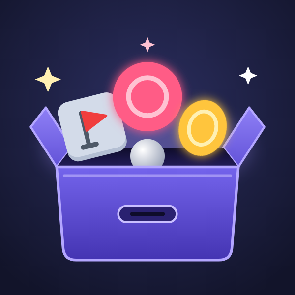
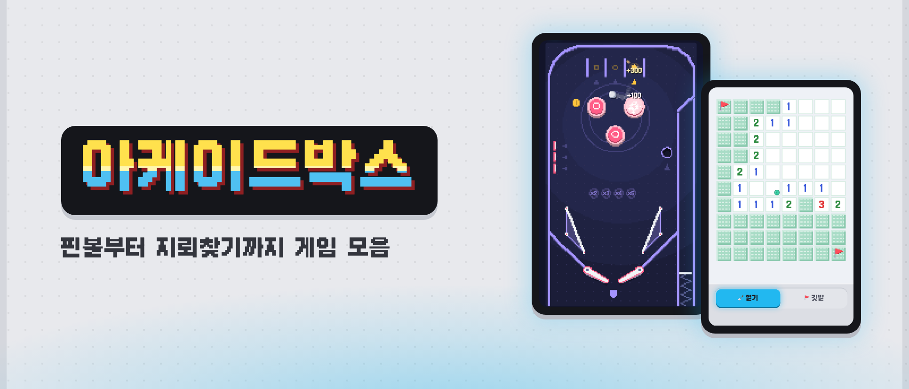
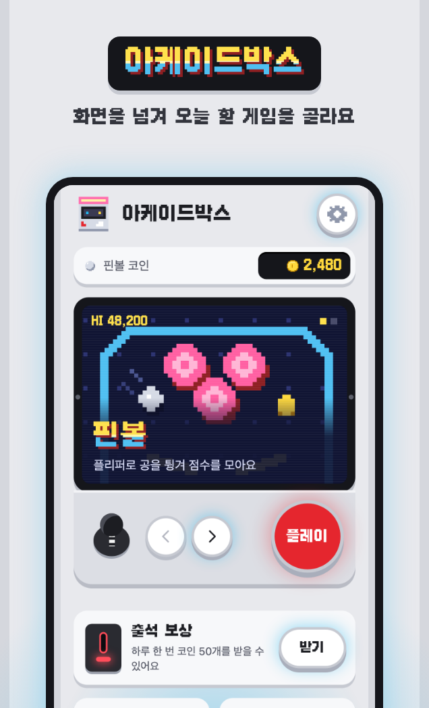
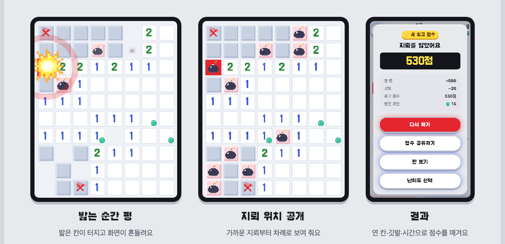
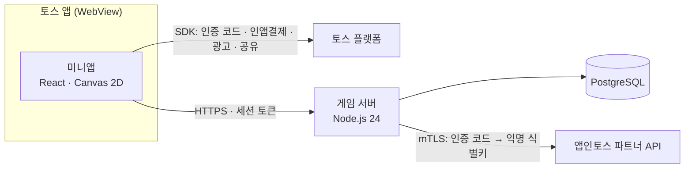

<div align="center">



# 아케이드박스 (Arcade Box)

**토스 앱 안에서 바로 즐기는 캐주얼 게임 모음 미니앱**

[](https://github.com/KrongDev/arcade-box/actions/workflows/ci.yml)

React 19 · TypeScript · Canvas 2D · Node.js 24 · PostgreSQL · Docker · GitHub Actions

</div>



## 소개

아케이드박스는 [앱인토스](https://developers-apps-in-toss.toss.im)(토스 미니앱) 플랫폼 위에서 도는 웹 게임 모음이에요. 핀볼에서 30,000점을 넘기면 지뢰찾기가 열리는 식으로 게임을 하나씩 열어 가고, 게임마다 모은 코인으로 핀볼의 판과 공, 지뢰찾기의 발판과 맵을 꾸며요.

화면은 오락실의 흰 오락기를 본떴어요. 회색 몸체에 검은 화면, 빛나는 동그란 버튼이 있고, 아이콘부터 게임 화면까지 모두 픽셀 그림이에요.

게임을 계속 더해 가는 것을 전제로, 게임 목록·잠금 조건·코인·순위표를 게임 단위로 나눠 설계했어요. 클라이언트, 게임 서버, 배포 파이프라인까지 담은 개인 프로젝트예요.

## 화면

| 홈 | 핀볼 | 지뢰찾기 | 상점 |
|:---:|:---:|:---:|:---:|
|  |  |  |  |

## 주요 기능

### 핀볼

- Canvas 2D로 그리는 자체 물리 엔진 — 범퍼, 슬링샷, 플리퍼, 발사 레인, 판 위에 떨어진 동전
- 누른 시간만큼 스프링이 당겨지는 발사대 — 오래 누를수록 세게 나가고, 1초 뒤부터는 최대 힘에 머물러요
- 위쪽 레인 불을 다 켜면 보너스 배율(×2~×5), 드롭 타깃을 다 쓰러뜨리면 구멍에 잠금 불 → 공을 넣으면 멀티볼(점수 2배), 멀티볼 중에 넣으면 잭팟
- 발사 직후 공을 잃으면 한 번 돌려주는 공 살리기, 짧은 간격으로 계속 맞히면 쌓이는 콤보
- 공 3개, 점수 구간마다 보너스 코인


### 지뢰찾기

- 초급(8×10) · 중급(12×18) · 고급(16×26) — 이전 단계를 깨야 다음 단계가 열려요
- 첫 칸은 항상 안전하고 넓게 열려요. 길게 눌러 깃발, 숫자 칸을 눌러 주변 한꺼번에 열기
- 큰 판을 위한 두 손가락 확대·축소, 끌어서 이동, 데스크톱 휠 확대
- 연 칸 · 맞힌 깃발 · 클리어 · 걸린 시간으로 매기는 점수 — 못 깨도 순위에 오르고, 깨면 빠를수록 높아요
- 누른 칸부터 번지듯 열리고, 판 곳곳에 숨은 동전을 찾으면 코인을 받아요
- 지뢰를 밟으면 폭발 연출과 함께 가까운 지뢰부터 차례로 위치를 보여 줘요



### 공통

- **게임별 코인** — 점수 구간 보너스, 판 위 동전, 클리어 보상, 출석(하루 50), 보상형 광고(하루 3번). 게임마다 코인 색이 달라요(핀볼 금색, 지뢰찾기 민트)
- **지금 고른 게임 하나를 앱 전체가 함께 써요** — 홈 오락기 화면에서 게임을 넘기면 위쪽 코인 액정이 그 게임 코인으로 바뀌고, 상점과 순위표도 그 게임으로 열려요. 상점 안에서 게임을 바꾸면 홈도 따라 바뀌어요
- **상점** — 코인 아이템과 유료(인앱결제, 평생 소장) 아이템으로 핀볼 판·공, 지뢰찾기 발판·맵 꾸미기. 아이템마다 능력(판 위 동전 더 자주, 동전 코인 +%, 지뢰 한 번 막기, 숨은 동전 더 많이)과 유료 이펙트(네온·은하수 판, 불꽃·번개 꼬리)가 있어요
- **게임별 순위표** — 익명 이름으로 표시
- **기기 간 동기화** — 다른 기기에서 열어도 코인·기록·아이템이 그대로
- 효과음·진동 설정, 점수 공유

## 아키텍처



## 기술적으로 신경 쓴 부분

### 1. 직접 만든 핀볼 물리

- 엔진(`src/pinball/engine.ts`)은 DOM에 의존하지 않는 순수 TypeScript로, Canvas 렌더러와 분리했어요. 화면 없이도 시뮬레이션을 돌려 공이 판 밖으로 빠지는 버그를 재현하고 고쳤어요.
- 한 프레임을 8번 나눠 적분하고 속도 상한을 둬서, 빠른 공이 얇은 벽을 뚫고 지나가지 않게 했어요.
- 벽과 플리퍼를 두께 있는 선분(캡슐)으로 보고 공과의 최근접점으로 충돌을 계산해요. 움직이는 플리퍼는 표면 속도를 반영해 공을 쳐 올려요.
- 발사 레인 바닥은 올라가는 공과는 부딪치지 않는 한 방향 벽이고, 공이 판에 들어가면 게이트가 닫혀 레인으로 되돌아가지 않아요.

### 2. 오프라인 우선 동기화, 서버가 정본

- 모든 행동은 기기에 먼저 반영해 바로 보이게 하고, 큐에 쌓아 서버로 차례로 보내요. 큐는 기기 저장소에 남아서 앱을 껐다 켜도 이어서 보내요.
- 네트워크·서버 오류는 3초 → 10초 → 30초 → 1분 → 5분 간격으로 다시 보내고, 규칙에 어긋난 요청은 버린 뒤 서버 상태로 맞춰요.
- 큐가 다 비었을 때만 서버 상태를 덮어써서, 아직 보내지 못한 변경이 사라지지 않아요.
- 서버에 처음 연결할 때 기기에 있던 진행 상황을 한 번만 가져와요(값마다 상한을 둬요).

### 3. 점수와 보상은 서버가 판정

- 지뢰찾기는 점수 대신 재료(연 칸, 맞힌·틀린 깃발, 클리어 여부, 시간)를 보내고, 서버가 판 크기로 가능한 값인지 검사한 뒤 같은 식으로 점수를 계산해요.
- 한 판에 받을 수 있는 코인에 게임별 상한을 두고, 판 기록은 3초에 한 번까지만 받아요.
- 출석·광고 보상의 하루 제한은 기기 시계가 아니라 서버의 한국 시간 기준이에요.

### 4. 사용자 식별과 보안

- 클라이언트가 보낸 식별키를 그대로 믿지 않아요. 앱이 받은 일회용 인증 코드를 서버가 mTLS로 파트너 API에 교환해 익명 식별키를 받아요.
- 세션 토큰은 SHA-256 해시로만 저장하고, 순위표에는 내부 사용자 ID의 해시로 만든 익명 이름("플레이어 1A2B")만 보여 줘요.
- CORS는 미니앱 origin만 정확히 허용해요. 운영 모드에서는 http 파트너 주소나 개발용 origin이 설정돼 있으면 서버가 시작하지 않아요.
- 비밀값은 저장소에 두지 않고 GitHub Actions secret으로만 넣어요 — [배포와 비밀값 관리](docs/deploy.md)

### 5. 픽셀 그림체를 코드로 그리기

- 핀볼 판은 1/3 해상도(134×234칸) 캔버스에 정수 칸 단위 `fillRect`로만 칠해 가장자리 흐림 없이 칸을 살리고, 이미지 보간을 끈 채 키워서 화면에 올려요(`src/pinball/pixel.ts`). 원·다각형·두꺼운 선은 가로줄 단위로 채우는 간단한 래스터라이저로 그려요.
- 바뀌지 않는 바닥·벽은 판 색이 바뀔 때만 한 번 그려 두고, 점수 팝업·큰 알림 글자만 원래 해상도에서 픽셀 글꼴로 따로 그려요. 매 프레임 칸을 다시 칠해도 데스크톱 브라우저 기준 60fps를 유지해요.
- 아이콘(16×16)은 문자열 칸 지도로, 홈 화면 게임 그림과 상점 미리보기는 칸 계산으로 만들어요. 같은 색 칸을 SVG `path` 하나로 묶어서 그림 하나의 DOM 노드가 색 수만큼만 생겨요.
- 색·글꼴·버튼 모양은 디자인 토큰(`src/styles/tokens.css`)과 공통 그림체(`src/styles/arcade.css`)에 모아 둬서, 보라색 테마에서 흰 오락기 테마로 바꿀 때 화면 코드를 거의 건드리지 않았어요.

### 6. 결제·광고 정책 지키기

- 인앱결제는 지급을 마친 뒤에만 성공으로 처리하고, 앱을 열 때 지급되지 않은 주문을 다시 처리해요. 기기를 바꾸면 구매 내역으로 복원하고, 환불된 아이템은 회수해요.
- 보상형 광고는 끝까지 봤다는 이벤트에서만 보상하고, 다음 광고를 미리 불러 둬요.

## 기술 스택

| 영역 | 사용 기술 |
|---|---|
| 클라이언트 | React 19, TypeScript, Vite, Canvas 2D, Web Audio, `@apps-in-toss/web-framework` 3.10, 픽셀 글꼴 [Galmuri](https://github.com/quiple/galmuri)(OFL) |
| 서버 | Node.js 24 (TypeScript 직접 실행), PostgreSQL 17, `pg` |
| 인프라 | Docker Compose, Caddy(HTTPS), GCP Compute Engine, GitHub Container Registry, GitHub Actions |
| 품질 | Node 내장 테스트 러너(서버 32개 테스트), oxlint, CI |

## 프로젝트 구조

```
arcade-box/
├─ src/
│  ├─ pinball/          핀볼 물리 엔진 · 픽셀 렌더러 · 타격 연출
│  ├─ minesweeper/      판 로직 · 확대/이동 제스처
│  ├─ game/             저장 · 동기화 큐 · 서버 API · 인앱결제 · 광고 · 상점 카탈로그 · 게임별 코인 색
│  ├─ components/       픽셀 아이콘 · 홈 화면 게임 그림 · 상점 미리보기
│  ├─ styles/           디자인 토큰 · 오락기 공통 그림체 · 픽셀 글꼴
│  └─ pages/            홈 · 핀볼 · 지뢰찾기 · 상점 · 순위표 · 설정 화면
├─ server/
│  ├─ src/              HTTP 라우트 · 게임 규칙 · 저장소(PostgreSQL/메모리) · 파트너 API
│  ├─ mock-partner/     로컬 개발용 가짜 파트너 API
│  └─ test/
├─ assets/              콘솔 등록용 로고 · 썸네일 · 스크린샷
└─ .github/workflows/   CI · 미니앱 배포 · 서버 배포
```

## 실행해 보기

```bash
npm install
(cd server && docker compose -f docker-compose.dev.yml up -d --build)   # 로컬 게임 서버 (가짜 파트너 API)
npm run dev                                                             # http://localhost:5173
```

브라우저에서는 `@apps-in-toss/devtools`가 토스 SDK를 흉내 내요. 서버가 없어도 기기 저장만으로 동작해요.

```bash
cd server && npm install && npm test   # 서버 테스트
```

배포 방법과 필요한 secret은 [docs/deploy.md](docs/deploy.md)에 정리해 뒀어요.
