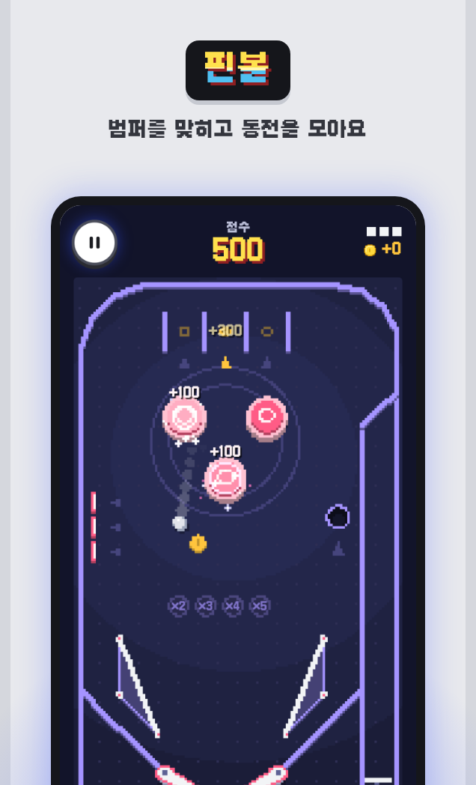
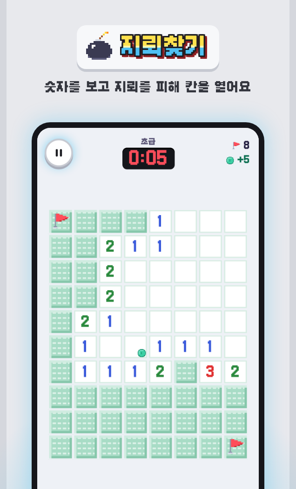
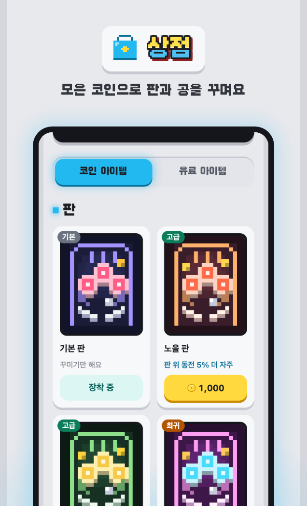
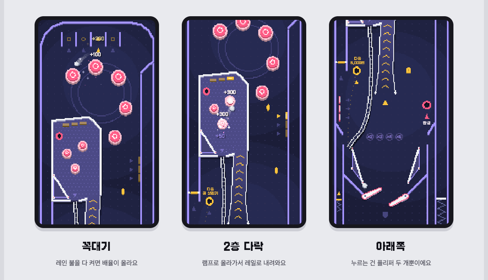
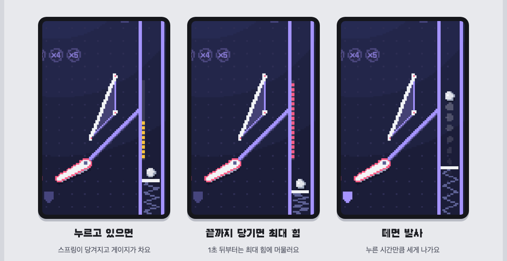
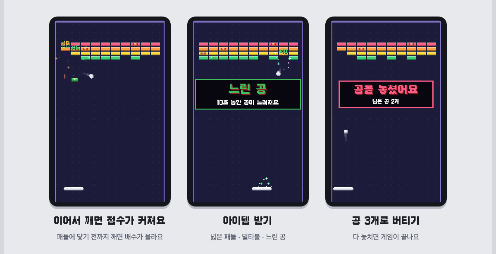
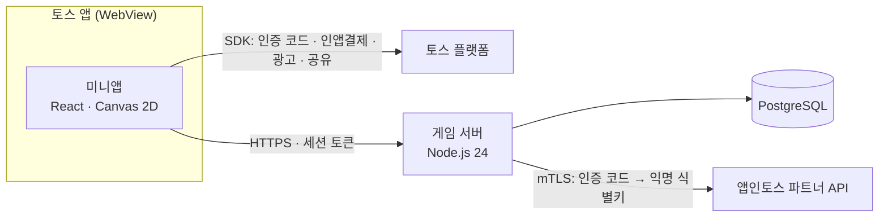

<div align="center">


# 아케이드박스 (Arcade Box)

**토스 앱 안에서 바로 즐기는 캐주얼 게임 모음 미니앱**

[](https://github.com/KrongDev/arcade-box/actions/workflows/ci.yml)

React 19 · TypeScript · Canvas 2D · Node.js 24 · PostgreSQL · Docker · GitHub Actions

**[안드로이드 테스터 모집 중 — 참여하기](https://arcade-api.geonbox.com/test)**

</div>


## 소개

아케이드박스는 [앱인토스](https://developers-apps-in-toss.toss.im)(토스 미니앱) 플랫폼 위에서 도는 웹 게임 모음이에요. 핀볼에서 30,000점을 넘기면 지뢰찾기가, 지뢰찾기 중급을 깨면 벽돌깨기가 열리는 식으로 게임을 하나씩 열어 가고, 게임마다 모은 코인으로 핀볼의 판과 공, 지뢰찾기의 발판과 맵, 벽돌깨기의 패들과 벽돌을 꾸며요.

화면은 오락실의 흰 오락기를 본떴어요. 회색 몸체에 검은 화면, 빛나는 동그란 버튼이 있고, 아이콘부터 게임 화면까지 모두 픽셀 그림이에요.

> 안드로이드 앱을 구글 플레이 비공개 테스트 중이에요. 안드로이드 폰과 Gmail만 있으면 2분이면 참여할 수 있어요 — [테스터 모집 페이지](https://arcade-api.geonbox.com/test)

게임을 계속 더해 가는 것을 전제로, 게임 목록·잠금 조건·코인·순위표를 게임 단위로 나눠 설계했어요. 같은 게임 코드를 안드로이드 앱(구글 플레이)으로도 내요. 클라이언트, 게임 서버, 배포 파이프라인까지 담은 개인 프로젝트예요.

## 화면

| 홈 | 핀볼 | 지뢰찾기 | 벽돌깨기 | 상점 |
|:---:|:---:|:---:|:---:|:---:|
|  |  |  |  |  |

## 주요 기능

### 핀볼

- Canvas 2D로 그리는 자체 물리 엔진. 판 "다락방 타워"는 화면보다 길어서(400×1300), 화면이 공을 따라 위아래로 움직여요
- 장치 33개 — 범퍼 8, 슬링샷 2, 자동 키커, 드롭 타깃 3, 타깃 6, 위쪽 레인 4, 구멍 3, 스피너, 램프, 레일, 킥백. 누르는 건 아래 플리퍼 두 개뿐이에요
- 램프로 공을 올리면 2층 다락 — 범퍼와 자동 키커가 공을 알아서 튕기고, 타깃 셋을 맞힌 뒤 구멍에 넣으면 다락 잭팟. 출구로 나온 공은 레일을 타고 왼쪽 플리퍼로 내려와요
- 위쪽 레인 불을 다 켜면 보너스 배율(×2~×5), 드롭 타깃을 다 쓰러뜨리면 구멍에 잠금 불 → 공을 넣으면 멀티볼(점수 2배), 멀티볼 중에 넣으면 잭팟
- 왼쪽 바깥 길로 빠진 공을 한 번 살려 주는 킥백(오른쪽 타깃 셋을 맞히면 다시 켜져요), 들어갈 때마다 정해진 차례로 보상을 주는 보너스 구멍, 돌아가는 길의 스피너
- 누른 시간만큼 스프링이 당겨지는 발사대 — 오래 누를수록 세게 나가고, 1초 뒤부터는 최대 힘에 머물러요
- 공이 플리퍼 앞에 내려온 뒤 5초 안에 잃으면 한 번 돌려주는 공 살리기, 짧은 간격으로 계속 맞히면 쌓이는 콤보
- 공 3개, 판 위 동전과 점수 구간마다 보너스 코인





### 지뢰찾기

- 초급(8×10) · 중급(12×18) · 고급(16×26) — 이전 단계를 깨야 다음 단계가 열려요
- 첫 칸은 항상 안전하고 넓게 열려요. 길게 눌러 깃발, 숫자 칸을 눌러 주변 한꺼번에 열기
- 큰 판을 위한 두 손가락 확대·축소, 끌어서 이동, 데스크톱 휠 확대
- 연 칸 · 맞힌 깃발 · 클리어 · 걸린 시간으로 매기는 점수 — 못 깨도 순위에 오르고, 깨면 빠를수록 높아요
- 누른 칸부터 번지듯 열리고, 판 곳곳에 숨은 동전을 찾으면 코인을 받아요
- 지뢰를 밟으면 폭발 연출과 함께 가까운 지뢰부터 차례로 위치를 보여 줘요


### 벽돌깨기

- 화면을 누른 채 좌우로 움직이면 패들이 따라오고, 손을 떼면 공이 출발해요. 패들 가운데에 맞으면 곧장, 끝에 맞으면 비스듬히 튀어요
- 배치 8가지를 한 바퀴 돌 때마다 단단한 벽돌(두 번 맞혀야 깨짐)이 늘고, 스테이지가 오를수록·오래 버틸수록 공이 빨라져요
- 동전 벽돌에서 떨어지는 동전을 패들로 받으면 코인, 아이템 벽돌에서는 넓은 패들 · 멀티볼 · 느린 공
- 패들에 닿지 않고 이어서 깨면 점수 배수가 올라가요(최대 5배). 스테이지를 깨면 보너스



### 공통

- **게임별 코인** — 점수 구간 보너스, 판 위 동전, 클리어 보상, 출석(하루 50), 보상형 광고(하루 3번). 게임마다 코인 색이 달라요(핀볼 금색, 지뢰찾기 민트, 벽돌깨기 주황)
- **지금 고른 게임 하나를 앱 전체가 함께 써요** — 홈 오락기 화면에서 게임을 넘기면 위쪽 코인 액정이 그 게임 코인으로 바뀌고, 상점과 순위표도 그 게임으로 열려요. 상점 안에서 게임을 바꾸면 홈도 따라 바뀌어요
- **상점** — 코인 아이템과 유료(인앱결제, 평생 소장) 아이템으로 핀볼 판·공, 지뢰찾기 발판·맵, 벽돌깨기 패들·벽돌 꾸미기. 아이템마다 능력(판 위 동전 더 자주, 동전 코인 +%, 지뢰 한 번 막기, 숨은 동전·동전 벽돌 더 많이)과 유료 이펙트(네온·은하수 판, 불꽃·번개 꼬리)가 있어요. 아직 잠긴 게임은 상점 위 게임 버튼에 자물쇠로 보여요
- **잠금 해제 연출** — 새 게임이나 다음 난이도가 열리면 결과 창 위에서 자물쇠가 덜컥거리다 픽셀 조각으로 부서지고, '잠금 해제!' 카드로 무엇이 열렸는지 알려 줘요
- **게임별 순위표** — 익명 이름으로 표시. 불러오는 동안 같은 자리에 뼈대를 보여 주고, 시상대가 3위·2위·1위 순으로 솟아요
- **기기 간 동기화** — 다른 기기에서 열어도 코인·기록·아이템이 그대로
- **내 기록 지우기** — 설정에서 서버와 기기의 코인·기록·아이템·순위표 기록을 한 번에 지워요
- 효과음·진동 설정, 점수 공유

## 아키텍처



## 기술적으로 신경 쓴 부분

### 1. 직접 만든 핀볼 물리

- 엔진(`src/pinball/engine.ts`)은 DOM에 의존하지 않는 순수 TypeScript로, Canvas 렌더러와 분리했어요. 화면 없이도 시뮬레이션을 돌려 공이 판 밖으로 빠지는 버그를 재현하고 고쳤어요.
- 판 배치(`table.ts`), 규칙 숫자(`rules.ts`), 물리와 규칙(`engine.ts`), 화면 따라가기(`camera.ts`)를 서로 다른 파일로 나눴어요. 예전 판에서 이어받은 규칙의 테스트(`test/pinball/rules.test.ts`)는 장치 위치를 판 배치에서 읽어 써서, 판을 400×700에서 400×1300으로 바꾸는 동안에도 같은 규칙을 계속 확인했어요.
- 2층 다락은 겹치는 층이 아니라 같은 평면 위의 닫힌 방이에요. 램프 입구는 올라온 공만, 출구는 다락 안의 공만 지나가는 한 방향 벽이라서 층이 겹치는 충돌 계산이 없어요. 다른 것 위를 지나가는 레일과 킥백, 두 구멍(보너스·잠금)의 미끄럼길은 물리 대신 정해진 길(`path.ts`)을 따라 움직여요.
- 화면이 공을 따라가는 규칙은 순수 함수로 두고, "아래로 떨어지는 공이 닿기 0.2초 전에는 플리퍼가 화면에 보인다"를 테스트로 지켜요. 공이 여럿이면 곧 플리퍼로 쳐야 할 공을 따라가고, 따라가던 공이 빠져도 화면이 한 번에 건너뛰지 않아요.
- 가짜 플레이어 둘(아무렇게나 누르는 봇, 공이 오면 누르는 봇)로 수백 판을 돌려 공이 끼거나 새는 곳을 찾고 점수와 코인의 균형을 맞췄어요(`test/pinball/soak·balance.test.ts`). 플리퍼 사이로 빠진 공이 옆으로 날아가 왼쪽 킥백을 받던 문제도 이렇게 찾았어요. 반대로 테스트가 놓친 것도 있었어요. 잠금 구멍이 뱉은 공이 플리퍼 사이로 떨어지던 문제는 테스트가 1초만 지켜보다 지나쳤고, 코드 검토에서 찾은 뒤 공이 플리퍼에 닿을 때까지 지켜보게 고쳤어요.
- 벽돌깨기도 같은 구조예요. 규칙(`src/breakout/rules·stages·engine.ts`)은 화면·SDK 없이 `node --test`로 바로 테스트하고, 난수와 스테이지 생성기를 바꿔 끼워 같은 판을 재현해요. 한 프레임을 1/240초씩 나눠 가장 빠른 공도 벽돌을 뚫지 않아요.
- 물리는 화면 주사율과 상관없이 늘 960분의 1초 간격으로 계산해요. 30Hz·60Hz·120Hz 어느 폰에서나 같은 순간에 플리퍼를 누르면 공이 같은 자리로 가요(`test/pinball/timestep.test.ts`). 속도 상한이 있어서 빠른 공이 얇은 벽을 뚫지 않고, 경사면에 얹힌 공은 미끄러지며 빨라져요.
- 벽과 플리퍼를 두께 있는 선분(캡슐)으로 보고 공과의 최근접점으로 충돌을 계산해요. 움직이는 플리퍼는 표면 속도를 반영해 공을 쳐 올려요.
- 발사 레인 바닥은 올라가는 공과는 부딪치지 않는 한 방향 벽이고, 공이 판에 들어가면 게이트가 닫혀 레인으로 되돌아가지 않아요.

### 2. 오프라인 우선 동기화, 서버가 정본

- 모든 행동은 기기에 먼저 반영해 바로 보이게 하고, 큐에 쌓아 서버로 차례로 보내요. 큐는 기기 저장소에 남아서 앱을 껐다 켜도 이어서 보내요.
- 네트워크·서버 오류는 3초 → 10초 → 30초 → 1분 → 5분 간격으로 다시 보내고, 규칙에 어긋난 요청은 버린 뒤 서버 상태로 맞춰요.
- 큐가 다 비었을 때만 서버 상태를 덮어써서, 아직 보내지 못한 변경이 사라지지 않아요.
- 서버에 처음 연결할 때 기기에 있던 진행 상황을 한 번만 가져와요(값마다 상한을 둬요).

### 3. 점수와 보상은 서버가 판정

- 지뢰찾기는 점수 대신 재료(연 칸, 맞힌·틀린 깃발, 클리어 여부, 시간)를 보내고, 서버가 판 크기로 가능한 값인지 검사한 뒤 같은 식으로 점수를 계산해요.
- 한 판에 받을 수 있는 코인에 게임별 상한을 두고, 판 기록은 3초에 한 번까지만 받아요.
- 출석·광고 보상의 하루 제한은 기기 시계가 아니라 서버의 한국 시간 기준이에요.

### 4. 사용자 식별과 보안

- 클라이언트가 보낸 식별키를 그대로 믿지 않아요. 앱이 받은 일회용 인증 코드를 서버가 mTLS로 파트너 API에 교환해 익명 식별키를 받아요.
- 세션 토큰은 SHA-256 해시로만 저장하고, 순위표에는 내부 사용자 ID의 해시로 만든 익명 이름("플레이어 1A2B")만 보여 줘요.
- CORS는 미니앱 origin만 정확히 허용해요. 운영 모드에서는 http 파트너 주소나 개발용 origin이 설정돼 있으면 서버가 시작하지 않아요.
- 비밀값은 저장소에 두지 않고 GitHub Actions secret으로만 넣어요 — [배포와 비밀값 관리](docs/deploy.md)
- 내 기록 지우기는 동기화 큐를 먼저 멈춘 뒤(보내는 중인 요청이 끝날 때까지 기다려요) 서버 기록을 지우고, 성공했을 때만 기기 기록을 지워요. 지우는 사이에 옛 기록이 서버로 다시 올라가지 않아요.
- 개인정보처리방침·이용약관은 `docs/*.md` 하나를 원본으로 서버가 HTML 페이지로 보여 줘요(외부 리소스를 막는 CSP). 테스터 모집 페이지(`/test`)도 같은 서버가 이미지·픽셀 글꼴까지 직접 줘요. 테스트가 원본과 서버 페이지가 같은지 확인해서 둘이 어긋나지 않아요.

### 5. 픽셀 그림체를 코드로 그리기

- 게임 판은 1/3 해상도(핀볼은 화면에 보이는 134×234칸, 벽돌깨기 120×200칸) 캔버스에 정수 칸 단위 `fillRect`로만 칠해 가장자리 흐림 없이 칸을 살리고, 이미지 보간을 끈 채 키워서 화면에 올려요. 원·다각형·두꺼운 선은 가로줄 단위로 채우는 간단한 래스터라이저로 그려요.
- 그리기 도구·타격 연출·충돌 판정·게임 루프·일시정지/결과 창은 게임 공용(`src/arcade/`, `src/components/game/`)으로 두고 게임마다 끼워 써요. 핀볼을 공용 모듈로 옮길 때는 옮기기 전후 화면을 픽셀 단위로 비교해 똑같은 걸 확인했어요.
- 바뀌지 않는 바닥·벽은 판 색이 바뀔 때만 한 번 그려 두고, 점수 팝업·큰 알림 글자만 원래 해상도에서 픽셀 글꼴로 따로 그려요. 핀볼은 판 전체(134×434칸)를 바닥·벽 한 장과 그 위에 올라가는 다락·램프·레일 한 장으로 그려 두고, 화면에 보이는 만큼만 잘라 써요. 매 프레임 칸을 다시 칠해도 데스크톱 브라우저 기준 60fps를 유지해요.
- 아이콘(16×16)은 문자열 칸 지도로, 홈 화면 게임 그림과 상점 미리보기는 칸 계산으로 만들어요. 같은 색 칸을 SVG `path` 하나로 묶어서 그림 하나의 DOM 노드가 색 수만큼만 생겨요.
- 색·글꼴·버튼 모양은 디자인 토큰(`src/styles/tokens.css`)과 공통 그림체(`src/styles/arcade.css`)에 모아 둬서, 보라색 테마에서 흰 오락기 테마로 바꿀 때 화면 코드를 거의 건드리지 않았어요.

### 6. 한 코드로 토스 미니앱과 안드로이드 앱

- 저장·사용자 식별·결제·광고·공유·진동·화면 여백·뒤로가기처럼 플랫폼마다 다른 기능은 `src/platform/`의 인터페이스 하나로 모았어요. 앱 코드는 SDK를 직접 부르지 않아요.
- 구현은 빌드할 때 하나만 들어가요(`vite build --mode android`면 Capacitor 구현). 토스 번들에는 Capacitor가, 안드로이드 앱에는 토스 SDK가 섞이지 않고, lint 규칙이 경계를 지켜요.
- 플랫폼에 없는 기능은 `null`이라 화면이 그 기능을 숨겨요. 안드로이드 첫 버전은 기기에만 저장하고 결제·광고·공유·순위표를 숨겨요 — [안드로이드 앱](docs/android.md)
- 안드로이드 출시 빌드는 R8로 코드·리소스를 줄여(앱 코드 7.1MB → 0.8MB) 외부와 전혀 통신하지 않아요. 구글 플레이 데이터 보안은 '수집 없음'이에요.

### 7. 결제·광고 정책 지키기

- 인앱결제는 지급을 마친 뒤에만 성공으로 처리하고, 앱을 열 때 지급되지 않은 주문을 다시 처리해요. 기기를 바꾸면 구매 내역으로 복원하고, 환불된 아이템은 회수해요.
- 보상형 광고는 끝까지 봤다는 이벤트에서만 보상하고, 다음 광고를 미리 불러 둬요.

## 기술 스택

| 영역 | 사용 기술 |
|---|---|
| 클라이언트 | React 19, TypeScript, Vite, Canvas 2D, Web Audio, `@apps-in-toss/web-framework` 3.10, Capacitor 8(안드로이드), 픽셀 글꼴 [Galmuri](https://github.com/quiple/galmuri)(OFL) |
| 서버 | Node.js 24 (TypeScript 직접 실행), PostgreSQL 17, `pg` |
| 인프라 | Docker Compose, Caddy(HTTPS), GCP Compute Engine, GitHub Container Registry, GitHub Actions |
| 품질 | Node 내장 테스트 러너(클라이언트 58개 · 서버 46개, 클라이언트·서버 규칙 값 일치 검사 포함), oxlint, CI |

## 프로젝트 구조

```
arcade-box/
├─ src/
│  ├─ platform/         플랫폼 모듈: 인터페이스 · 토스 미니앱 구현 · 안드로이드(Capacitor) 구현
│  ├─ arcade/           게임 공용: 픽셀 그리기 · 타격 연출 · 충돌 판정 · 캔버스 게임 루프
│  ├─ pinball/          핀볼 판 배치 · 규칙 · 물리 엔진 · 화면 따라가기 · 픽셀 렌더러 · 타격 연출
│  ├─ minesweeper/      판 로직 · 확대/이동 제스처
│  ├─ breakout/         벽돌깨기 규칙(스테이지·엔진) · 렌더러 · 타격 연출
│  ├─ game/             게임 목록·잠금 규칙 · 저장 · 동기화 큐 · 서버 API · 인앱결제 · 광고 · 상점 카탈로그 · 게임별 코인 색
│  ├─ components/       픽셀 아이콘 · 홈 화면 게임 그림 · 상점 미리보기 · 일시정지/결과 창
│  ├─ styles/           디자인 토큰 · 오락기 공통 그림체 · 액션 게임 화면 · 픽셀 글꼴
│  └─ pages/            홈 · 핀볼 · 지뢰찾기 · 벽돌깨기 · 상점 · 순위표 · 설정 화면
├─ test/                클라이언트 규칙 테스트 (node --test)
├─ server/
│  ├─ src/              서버 v2: 도메인별 디렉토리(계정 · 지갑 · 상품 · 보유 · 주문 · 게임 · 판 결과 · 보상) · 명령줄 도구 · 약관 페이지
│  ├─ drizzle/          DB 마이그레이션 SQL
│  ├─ scripts/          운영 도구를 부르는 스크립트(admin.sh) · 약관 페이지 만들기
│  └─ test/ · test-pg/  서버 테스트 · 진짜 PostgreSQL에서만 도는 동시 요청 테스트
├─ android/             안드로이드 앱 프로젝트 (Capacitor · Android Studio)
├─ assets/              콘솔 등록용 로고 · 썸네일 · 스크린샷
└─ .github/workflows/   CI · 미니앱 배포 · 서버 배포
```

## 실행해 보기

```bash
npm install
(cd server && docker compose -f docker-compose.dev.yml up -d --build)   # 로컬 게임 서버 v2 (앱은 아직 /v1을 불러 이어지지 않아요)
npm run dev                                                             # http://localhost:5173
npm run dev:android                                                     # 안드로이드 구현으로 브라우저에서 보기
```

브라우저에서는 `@apps-in-toss/devtools`가 토스 SDK를 흉내 내요. 서버가 없어도 기기 저장만으로 동작해요.

> 서버는 v2로 다시 만들었어요 (계정 · 통일 코인 · 상품과 보유 · 주문 · 게임 목록 — [`server/README.md`](server/README.md)). 앱은 아직 v1 서버(`/v1`)를 부르고, 앱 구조 작업에서 `/v2`로 바뀌어요. 이 문서의 서버 이야기(토스 인증 코드 교환, 게임별 코인)는 그때 함께 고쳐요. **그 전에는 서버 v2를 운영에 배포하지 않아요.**

```bash
npm test                               # 클라이언트 규칙 테스트
cd server && npm install && npm test   # 서버 테스트
```

배포 방법과 필요한 secret은 [docs/deploy.md](docs/deploy.md)에, 안드로이드 앱 빌드와 구글 플레이 출시는 [docs/android.md](docs/android.md)에 정리해 뒀어요. [개인정보처리방침](https://arcade-api.geonbox.com/privacy)과 [이용약관](https://arcade-api.geonbox.com/terms)은 토스 미니앱과 안드로이드 앱에 함께 써요(원본: `docs/privacy-policy.md`, `docs/terms.md`).
