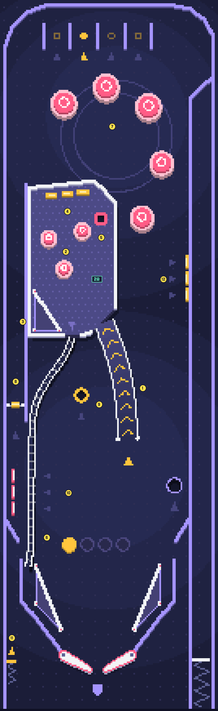

# 핀볼 새 판 "다락방 타워" 설계

2026-11-25 · 상태: 사용자 확인 대기

## 1. 왜 만드나

사용자 요청은 세 가지예요. 핀볼 판을 더 크게, 장치를 훨씬 많이, 그리고 2층으로 올라가는 길을 넣는 것.

지금 판은 400×700으로 한 화면에 다 보이고 장치는 14개예요 (플리퍼 2, 슬링샷 2, 범퍼 3, 드롭 타깃 3, 위쪽 레인 3, 구멍 1).

## 2. 목표와 범위

### 목표

- 판을 400×1300으로 키워요. 화면은 지금과 같은 400×700 범위만 보여 주고, 공을 따라 위아래로 움직여요. 공과 장치의 화면 크기는 지금과 같아요.
- 장치를 33개로 늘려요 (5.1의 표).
- 2층 다락을 넣어요. 램프로 올라가고, 다락 출구에서 공중 레일을 타고 왼쪽 플리퍼로 내려와요.
- 지금 규칙은 남겨요: 위쪽 레인 배율, 드롭 타깃 → 잠금 → 멀티볼, 멀티볼 잭팟, 공 살리기, 콤보, 판 위 동전, 점수 구간 코인.
- 상점의 판·공 스킨과 능력(동전 빈도, 동전 코인 +%), 유료 이펙트(네온, 은하수, 꼬리)는 그대로 적용돼요.

### 하지 않는 것

- 2층이나 위쪽에 플레이어가 누르는 플리퍼. **누르는 플리퍼는 아래 두 개뿐이에요** (사용자가 정함).
- 예전 판을 골라서 할 수 있게 남기기. 새 판이 예전 판을 대신해요.
- 서버 변경. 점수 상한(500만), 한 판 코인 상한(400), 지뢰찾기 잠금 점수(핀볼 30,000점)는 그대로예요.
- 순위표나 개인 최고 기록 지우기.
- 상점 아이템 추가.

### 이렇게 되면 실패

- 공이 어딘가에 끼어서 판이 멈춘다.
- 공이 아래로 내려올 때 플리퍼가 화면에 안 보여서 칠 수 없다.
- 점수나 코인이 서버 상한을 넘어서 기록이 거절된다.
- 보통 폰에서 프레임이 눈에 띄게 끊긴다.
- 실제로 있는 특정 핀볼 게임의 판·이름·그림을 닮는다 (PRD의 "특정 게임 그래픽 모방 금지").

## 3. 지켜야 할 조건

- 엔진은 DOM에 기대지 않는 순수 TypeScript로 두고 `node --test`로 테스트해요 (벽돌깨기와 같은 방식: `src/breakout/rules.ts`·`engine.ts`, `test/breakout/`). 테스트가 읽는 파일은 상대 경로 import에 `.ts` 확장자를 써요.
- `test/parity.test.ts`가 계속 통과해야 해요. 이 테스트는 `src/pinball/engine.ts`에서 `MAX_COINS_PER_RUN`, `MAX_SCORE`를 읽어요.
- 그림은 지금 방식 그대로예요. 낮은 해상도 캔버스(한 칸 = 판 좌표 3)에 정수 칸 `fillRect`로만 칠하고, 흐림 없이 키워요 (`src/arcade/pixel.ts`).
- 색은 스킨이 주는 11가지(`PinballTableLook`)와 공 색 2가지만 써요. 새 색을 스킨에 추가하지 않아요.
- 캔버스 글자도 12px 이상이에요 (`AGENTS.md` 하드 규칙).
- '동작 줄이기' 설정이면 화면 흔들림·번쩍임은 지금처럼 꺼요. 화면이 공을 따라가는 움직임은 게임에 필요해서 그대로 둬요.
- 토스 미니앱과 안드로이드 앱이 같은 코드를 써요. 플랫폼 코드는 건드리지 않아요.
- 푸시와 배포는 사용자 확인을 받은 뒤에 해요.

## 4. 검토한 방법

판을 키우고 2층을 넣는 방법을 세 가지로 그려서 사용자에게 보여 줬어요.

| 후보 | 내용 | 좋은 점 | 아쉬운 점 |
|---|---|---|---|
| 1 다락방 타워 | 400×1300. 판 왼쪽 위에 2층 다락, 램프로 올라가고 레일로 내려옴 | 진짜 핀볼 기계처럼 보임 | 화면이 공을 계속 따라가야 함 |
| 2 롤러코스터 | 400×1100. 램프 2개와 공중 레일 2개, 2층은 타고 지나가는 길 | 빠르고 시원함 | 2층에서 노는 곳이 없음 |
| 3 2층 건물 | 400×1400. 지금 판이 2층, 아래에 1층을 새로 만듦. 층마다 플리퍼 | 플리퍼가 항상 보임 | 층이 겹치지 않음. 플리퍼가 4개 |

**사용자가 후보 1을 골랐어요.** 그리고 후보 1에 있던 2층 미니 플리퍼를 빼 달라고 했어요. 받은 피드백이 "치는 건 아래 플리퍼만"이기 때문이에요. 그래서 2층 다락은 공이 알아서 튕기는 방(범퍼 3개, 자동 키커)으로 바꿨고, 사용자가 그 그림을 보고 확정했어요.

## 5. 설계

### 5.1 판 한눈에



| 번호 | 장치 | 하는 일 |
|---|---|---|
| 1 | 램프 | 왼쪽 플리퍼로 넣으면 2층 다락으로 올라가요 |
| 2 | 2층 범퍼 3개 | 올라온 공을 알아서 튕겨요 |
| 3 | 자동 키커 | 슬링샷처럼 공이 닿으면 알아서 위로 차 올려요 |
| 4 | 2층 타깃 3개 | 다 맞히면 잭팟 구멍에 불이 켜져요 |
| 5 | 2층 잭팟 구멍 | 불이 켜졌을 때 들어가면 다락 잭팟 |
| 6 | 출구와 내려오는 레일 | 다락 출구로 빠진 공을 왼쪽 플리퍼 쪽으로 내려보내요 |
| 7 | 범퍼 5개, 위쪽 레인 4개 | 지금은 3개씩이에요 |
| 8 | 돌아가는 길과 스피너 | 왼쪽 벽을 타고 꼭대기로 올라가요. 지나갈 때 스피너가 돌며 점수를 줘요 |
| 9 | 뽑기 구멍 | 들어가면 보상 하나를 뽑아요 |
| 10 | 드롭 타깃 3개 | 다 쓰러뜨리면 오른쪽 잠금 구멍에 불 → 넣으면 멀티볼 (지금과 같음) |
| 11 | 옆으로 빠지는 길과 킥백 | 왼쪽은 킥백이 켜져 있으면 한 번 살려 줘요 |
| 12 | 오른쪽 타깃 3개 | 다 맞히면 킥백이 다시 켜져요 |

장치 수: 플리퍼 2, 슬링샷 2, 자동 키커 1, 범퍼 8(1층 5 + 2층 3), 드롭 타깃 3, 타깃 6(오른쪽 3 + 2층 3), 위쪽 레인 4, 구멍 3(잠금, 뽑기, 잭팟), 스피너 1, 램프 1, 레일 1, 킥백 1. 모두 33개.

### 5.2 좌표 초안

판 좌표는 가로 400, 세로 1300이고 왼쪽 위가 (0, 0)이에요. 아래 값은 그림을 그릴 때 쓴 초안이에요. 만들면서 시뮬레이션과 실제 플레이로 다듬어도 돼요. 다만 장치의 종류·개수와 서로의 위치 관계(무엇이 무엇 옆에 있는지)는 그림대로 지켜요.

```text
바깥 벽      (8,1300) (8,90) (22,50) (50,22) (90,8) (310,8) (350,16) (378,36) (392,64) (392,1300)
발사 레인    안쪽 벽 x=350, y 180~1300 · 문 (350,180)-(392,140) · 발사대 머리 y=1210
위쪽 레인    불 x=105,155,205,255 / y=66 · 기둥 x=80,130,180,230,280 / y 44~86
1층 범퍼     (118,190) (196,160) (274,196) 반지름 22 · (298,300) (262,400) 반지름 20
돌아가는 길  왼쪽 벽과 안쪽 벽 x=48 (y 340~772) 사이 · 스피너 (29,744) 폭 26
다락 테두리  (54,345) (175,332) (212,372) (212,565) [램프 입구] (168,610) (150,616) [출구] (116,616) (54,616)
             램프 입구는 (212,565)~(168,610) 사이, 출구는 (150,616)~(116,616) 사이가 뚫려 있어요
2층 타깃     가로 막대 3개: x 84~106, 113~135, 142~164 / y 352~358 근처
2층 잭팟 구멍 (186,402) 반지름 11
2층 범퍼     (90,438) (152,424) (118,494) 반지름 13
자동 키커    삼각형 (63,536) (63,606) (110,606). 차는 면은 (110,606)-(63,536)
램프         가운데 선 (236,806) (232,730) (218,660) (192,592), 폭 36
레일         (133,620) (122,652) (90,694) (63,742) (58,800) (58,1004) (52,1040)
오른쪽 타깃  x=344 벽에 세로 막대 3개: y 470~494, 500~524, 530~554
뽑기 구멍    (150,726) 반지름 12
잠금 구멍    (322,892) 반지름 13
드롭 타깃    x=24에 세로 막대 3개: y 862~886, 892~916, 922~946
배율 불      y=1000, x=128,161,194,227 (×2~×5)
플리퍼       축 (118,1204) (242,1204), 길이 54, 쉬는 각 0.5rad, 올린 각 -0.45rad (오른쪽은 대칭)
슬링샷       왼쪽 (66,1040) (66,1108) (112,1156). 오른쪽은 x=180 기준 대칭
안쪽·바깥 길 나눔벽 x=38, y 1030~1100, 이어서 (38,1100)-(116,1200) 경사. 오른쪽은 대칭
지붕 가이드  (8,950)-(34,992), (350,950)-(324,992)
킥백         왼쪽 바깥 길 아래 (22,1212)
공 살리기 표시 (180,1268)
```

지금 판의 아래쪽은 벽에서 플리퍼로 바로 이어지는 경사 하나였어요. 새 판은 안쪽 길(플리퍼로 감)과 바깥 길(옆으로 빠짐)로 나뉘어요.

**지붕 가이드(내가 정함).** 바깥 길 바로 위에 비스듬한 가이드를 둬요. 벽을 타고 내려온 공은 가이드를 따라 안쪽 길로 가고, 슬링샷 근처에서 옆으로 튕긴 공만 가이드 끝과 나눔벽 사이 틈으로 바깥 길에 들어가요. 바깥 길로 빠지는 일이 드물게 일어나도록 하려는 거예요. 틈의 크기는 6.2의 기준에 맞춰 다듬어요.

### 5.3 물리

지금 엔진의 방식은 그대로 써요: 한 프레임을 8번 나눠 적분, 속도 상한, 벽과 플리퍼를 두께 있는 선분(캡슐)으로 보는 충돌, 범퍼·슬링샷의 차는 힘.

**2층 다락은 같은 평면 위의 닫힌 방이에요.** 다락 테두리는 보통 벽이고, 다락 아래에는 1층 장치를 두지 않아요. 그래서 층이 겹치는 충돌 계산이 필요 없어요. 다락은 램프 입구와 출구 두 곳으로만 바깥과 이어져요. 실제로 다른 것 위를 지나가는 건 레일 하나뿐이에요.

공에는 층 표시를 둬요 (`level`: 0 = 1층, 1 = 2층). 쓰는 곳은 그리는 순서, 2층 점수 규칙, 화면이 따라갈 공 고르기, 끼임 방지예요.

**램프.**
- 양옆 난간은 벽이에요. 1층 공은 아래 입구로만 들어갈 수 있어요.
- 램프 안에서는 내리막 방향으로 가속을 더해요 (오르막이라 느려지는 것). 속도가 모자라면 입구로 되굴러 나와요.
- 꼭대기 선을 위로 넘으면 2층이 돼요 (`level = 1`). 이때 램프 점수를 줘요.
- 꼭대기 선은 2층 공에게 한 방향 벽이에요. 다락에 올라온 공은 램프로 되돌아 내려가지 않아요.
- 입구는 깔때기처럼 넓게 벌리고, 아래쪽 방향은 공이 날아오는 방향에 맞춰요. 지금 엔진으로 왼쪽 플리퍼 샷을 재 보니, 램프 입구 높이(플리퍼 축에서 398 위)에서 공의 속도는 약 1,250이고 방향은 위에서 오른쪽으로 10도쯤 기울어요. 가로 위치는 치는 순간에 따라 크게 달라져요 (공이 플리퍼 위에서 1만큼 더 굴러가면 약 10). 입구가 좁으면 맞히기가 너무 어려워요.

**레일.**
- 다락 출구 틈 바로 아래에 감지 구역을 둬요. 2층 공이 닿으면 레일 타기를 시작해요.
- 레일 위의 공은 정해진 길을 따라 움직여요. 다른 것과 부딪히지 않아요. 속도는 느리게 시작해서 내려가며 빨라지고 상한이 있어요.
- 길 끝(왼쪽 안쪽 길 위)에서 아래쪽 속도를 주고 놓아줘요. 이때 1층이 돼요 (`level = 0`).
- 멀티볼로 공 두 개가 같이 탈 수 있어요. 뒤 공이 앞 공을 지나치지 않게 간격을 둬요.

**킥백.**
- 왼쪽 바깥 길 아래에 감지 구역을 둬요.
- 킥백 불이 켜져 있으면 공을 살려요. 레일과 같은 방식으로, 바깥 길을 거슬러 올라가 틈 밖(왼쪽 슬링샷 위)으로 나가는 정해진 길을 따라 올려 보낸 뒤 놓아줘요. 불은 꺼져요.
- 불이 꺼져 있으면 공은 그대로 아래로 빠져요.
- 오른쪽 바깥 길에는 킥백이 없어요.
- 킥백 불은 공을 새로 받을 때마다 켜져요.

**구멍 세 개.** 지금 잠금 구멍과 같은 방식이에요. 공이 가운데에 가까이 오면 붙잡고, 잠깐 뒤에 정해진 방향으로 뱉어요. 뱉는 방향은 공이 곧장 빠지지 않는 쪽으로 정해요.

**발사.** 레인이 판 전체 높이(1300)로 길어져요. 발사 속도 범위와 속도 상한을 올려서, 스프링을 3분의 1쯤만 당겨도 공이 레인을 빠져나가게 해요. 약하게 쏴서 레인으로 되떨어진 공을 잃지 않는 지금 규칙은 그대로 둬요.

**끼임 방지.**
- 지금처럼 공이 2.5초 넘게 거의 멈춰 있으면 살짝 튕겨 줘요.
- 공이 2층에 20초 넘게 있으면 출구로 보내 레일을 태워요 (내가 정함).

### 5.4 규칙과 점수

지금 규칙은 모두 남아요. 기본 점수에 레인 배율(×1~×5)과 멀티볼 2배가 곱해지는 것도 같아요. 새 장치의 점수는 아래 값으로 시작하고 6.2의 기준에 맞춰 다듬어요.

| 장치 | 점수와 규칙 |
|---|---|
| 위쪽 레인 4개 | 지날 때 300. 넷을 다 켜면 3,000과 배율 +1. 플리퍼를 누르면 켜진 불이 옆으로 옮겨 가는 것도 지금과 같아요 |
| 1층 범퍼, 슬링샷, 드롭 타깃, 잠금 구멍, 멀티볼, 잭팟 | 지금과 같아요 (100 / 30 / 500, 다 쓰러뜨리면 5,000 / 2,000 / 멀티볼 중 20,000) |
| 스피너 | 공이 지나가면 속도에 따라 1~8번 돌아요. 한 번 돌 때마다 100 |
| 오른쪽 타깃 | 하나에 300. 셋을 다 맞히면 2,000을 주고 킥백을 다시 켜요. 그 뒤 불은 꺼지고 다시 시작해요 |
| 뽑기 구멍 | 하나를 뽑아요: 3,000점 / 10,000점 / 코인 +10 / 공 살리기 다시 켜기 / 잠금 불 켜기. 비율은 40 / 20 / 20 / 10 / 10 |
| 램프 | 2층에 올라가면 2,000. 12초 안에 또 올리면 2배, 3배로 커지고 5배까지예요 |
| 2층 범퍼 | 200 |
| 자동 키커 | 50 |
| 2층 타깃 | 하나에 1,000. 셋을 다 맞히면 잭팟 구멍에 불이 켜지고, 타깃은 다시 올라와요 |
| 2층 잭팟 구멍 | 불이 켜졌으면 다락 잭팟 25,000을 주고 불이 꺼져요. 꺼져 있으면 2,000 |

- 콤보는 지금 규칙 그대로예요. 새 장치 중 2층 범퍼, 자동 키커, 오른쪽 타깃, 2층 타깃, 구멍은 콤보에 들어가고 스피너는 들어가지 않아요.
- 판 위 동전은 지금처럼 최대 3개가 1층의 빈 곳에 생겨요. 다락, 램프, 발사 레인, 장치 근처에는 생기지 않아요.
- 점수 구간 코인(1만 10개, 3만 20개, 5만 30개)과 공 3개, 공 살리기 8초는 그대로예요.
- 뽑기 구멍의 코인도 한 판 코인 상한(400) 안에서만 줘요. 공 스킨의 코인 +% 능력은 판 위 동전에만 붙고 뽑기 코인에는 붙지 않아요.
- 뽑기의 "공 살리기 다시 켜기"는 발사 직후와 같은 상태(8초, 한 번)로 되돌리는 거예요. "잠금 불 켜기"는 드롭 타깃을 다 쓰러뜨렸을 때와 같아요.
- 뽑기는 엔진에 넣는 난수 함수로 정해요. 테스트에서 같은 결과를 다시 만들 수 있어야 해요.

### 5.5 화면이 공을 따라가는 방식

- 보이는 범위는 400×700이고, 위아래로 0~600만큼 움직여요.
- **따라갈 공.** 판 위에 공이 하나면 그 공이에요. 여러 개면 1층에 있는 공 중 가장 아래에 있는 공이에요 (플리퍼에 가장 가까운 공). 1층에 공이 없으면 가장 아래 공이에요.
- **목표 위치.** 공이 화면 가운데쯤에 오게 하고, 공이 아래로 빠르게 내려올 때는 아래쪽을 더 보여 줘요. 공이 판 아래쪽 3분의 1에 있으면 화면은 맨 아래에 붙어서 플리퍼가 항상 보여요.
- 화면은 부드럽게 따라가요. 다만 공이 화면 밖으로 나가려 하면 바로 따라붙어요.
- 화면 위치는 3의 배수로 맞춰요. 픽셀이 떨리지 않게 하려는 거예요.
- 공이 발사대에 있을 때는 화면이 맨 아래에 있어요. 발사하면 공을 따라 올라가요.
- 멀티볼 중 화면 밖에 있는 공은 화면 위쪽 가장자리에 작은 표시로 알려 줘요.
- 이 계산은 그리기와 떼어 낸 순수 함수로 만들어 테스트해요.
- **기준.** 벽에 부딪히지 않고 곧장 떨어지는 가장 빠른 공이어도, 공이 플리퍼 높이에 닿기 0.2초 전에는 플리퍼가 화면에 다 보여야 해요. 미리 재 본 값이 있어요. 목표 위치를 `공 y − 350 + (아래 속도 × 0.22, −140~220 사이)`로 잡고 1초에 10배 비율로 따라가게 했더니, 여러 높이·속도에서 0.20~0.41초의 여유가 나왔어요. 이 수식과 숫자는 출발점이고 더 좋게 다듬어도 돼요.

### 5.6 그리기

- 낮은 해상도 캔버스는 보이는 범위 크기(134×234칸)로 두고, 그릴 때 세로로 밀어서 그려요.
- 바뀌지 않는 그림은 판 전체 크기로 미리 그려 둬요. 두 장이에요: 바닥과 벽 한 장, 그 위에 올라가는 다락·램프·레일 한 장. 스킨이 바뀌면 다시 그려요.
- 그리는 순서: 바닥과 벽 → 바닥 표시등 → 1층 장치 → 1층 공 → 다락·램프·레일 → 2층 장치 → 램프 위나 2층에 있는 공 → 레일 위 공 → 파편과 번쩍임.
- 레일 위 공은 그림자를 더 멀리 떨어뜨려서 떠 있는 느낌을 줘요.
- 새로 그릴 것: 다락(밝은 바닥, 흰 테두리, 아래 그림자), 램프(올라가는 방향 화살표 무늬), 레일(두 줄과 침목), 스피너(돌 때 폭이 변함), 타깃 불, 킥백, 뽑기 구멍, 지붕 가이드, 화면 밖 공 표시. 다락·램프·레일의 모양은 5.1 그림과 같게 해요.
- 불이 켜진 상태를 보여 줘요: 잭팟 구멍(깜빡임), 킥백, 램프 연속(램프 앞 화살표), 오른쪽 타깃.
- 점수 팝업과 큰 알림 글자는 지금처럼 원래 해상도에서 픽셀 글꼴로 써요. 팝업 위치는 화면이 움직인 만큼 옮겨요.
- 은하수 스킨의 별은 판 전체 높이에 뿌려요.

### 5.7 화면, 소리, 진동

- `Pinball.tsx`의 캔버스 크기는 보이는 범위(400×700) 그대로예요. 상단 표시(점수, 남은 공, 코인)와 조작, 일시정지, 결과 창은 바꾸지 않아요.
- 새 사건에 큰 알림을 띄워요: 2층에 올라감, 램프 연속, 다락 잭팟 준비, 다락 잭팟, 킥백, 뽑기 결과.
- 새 사건에 소리와 진동을 붙여요. 소리는 `src/game/sfx.ts`에 필요한 만큼만 더하고, 있는 소리로 되는 건 그대로 써요.

### 5.8 서버와 기록 (내가 정함)

- 서버는 바꾸지 않아요.
- 순위표와 개인 최고 기록은 지우지 않아요. 지금은 닫힌 테스트 단계라 기록이 적고, 지우면 되돌릴 수 없기 때문이에요.
- 새 판은 예전 판보다 점수가 조금 더 잘 나오게 맞춰요 (6.2). 그러면 예전 기록은 자연스럽게 넘어가요.
- 지뢰찾기 잠금 점수 30,000점은 그대로 둬요. 새 판에서는 조금 쉬워져요.

### 5.9 문서

- `README.md`의 핀볼 설명과 판 크기 설명을 새 판에 맞춰 고쳐요.
- 스토어 스크린샷(`assets/screenshot-2.png`)과 스토어 문구는 출시할 때 사용자와 함께 바꿔요. 이 작업에는 넣지 않아요.

## 6. 테스트와 완료 기준

### 6.1 자동 테스트 (`test/pinball/`)

- 발사: 충분히 당겨 쏜 공은 레인을 빠져나가 판에 들어가요. 약하게 쏜 공은 발사대로 돌아와요.
- 램프: 입구에 충분한 속도로 들어온 공은 2층에 올라가고 램프 점수를 받아요. 느린 공은 되굴러 나와요.
- 다락: 타깃 셋을 맞히면 잭팟 불이 켜지고, 그 뒤 구멍에 들어가면 다락 잭팟을 받아요.
- 레일: 출구로 빠진 공은 레일을 타고 왼쪽 안쪽 길에 내려와 왼쪽 플리퍼에 닿아요.
- 킥백: 켜져 있으면 한 번 살리고 꺼져요. 오른쪽 타깃 셋을 맞히면 다시 켜져요.
- 지금 규칙: 레인 배율, 드롭 타깃 → 잠금 → 멀티볼, 멀티볼 잭팟, 공 살리기, 콤보, 점수 구간 코인, 코인 상한, 점수 상한.
- 뽑기: 난수를 정해 주면 정해진 보상이 나와요.
- 화면 따라가기: 따라갈 공 고르기, 범위 안에 머물기, 아래쪽에서는 맨 아래에 붙기.
- 무작위 플레이: 난수로 플리퍼를 누르는 봇으로 여러 판을 돌려요. 숫자가 깨지지 않고(NaN 없음), 공이 판 밖으로 새지 않고, 5초 넘게 멈춘 공이 없고, 판이 끝까지 가요.

### 6.2 균형 기준

같은 봇으로 예전 판과 새 판을 각각 여러 판 돌려서 맞춰요. 봇은 두 가지예요.

- **무작위 봇**: 0.15~0.65초마다 왼쪽이나 오른쪽을 아무렇게나 0.12~0.32초 눌러요. 발사 세기는 75~100%예요.
- **반응 봇**: 공이 플리퍼 바로 위(판 바닥에서 70~130 위)로 내려오면 그쪽 플리퍼를 눌러요.

예전 판에서 300판씩 잰 값이에요 (2026-11-25, 고치기 전 엔진).

| 봇 | 점수 중앙값 | 하위 10% / 상위 10% | 한 판 길이 중앙값 | 코인 중앙값 | 30,000점 넘긴 판 |
|---|---|---|---|---|---|
| 무작위 | 24,730 | 11,170 / 71,120 | 38초 | 45 | 41% |
| 반응 | 5,000,000 (상한) | 2,360,690 / 상한 | 725초 | 400 (상한) | 100% |

예전 판은 옆으로 빠지는 길이 없어서, 공이 올 때마다 누르기만 하면 거의 죽지 않아요. 그래서 반응 봇은 12분쯤 버티다 점수 상한에 닿아요. 새 판은 바깥 길이 생겨서 이 점이 나아져요.

- 무작위 봇의 새 판 점수 중앙값이 예전 판의 1~2.5배예요 (약 25,000~62,000).
- 반응 봇의 새 판 점수 중앙값이 상한(500만)에 닿지 않아요.
- 왼쪽 플리퍼에 얹힌 공을 제때 치면 램프에 올라가요. 봇이 아니라 정해진 타이밍으로 치는 테스트로 확인해요.
- 바깥 길로 공을 잃는 일이 전체 공 잃기의 3분의 1을 넘지 않아요.
- 점수와 코인이 상한을 넘지 않아요.

### 6.3 끝났다고 말하려면

- `npm test`, 타입 검사, 린트, 토스·안드로이드 빌드가 통과해요.
- 브라우저에서 직접 한 판을 해서 램프, 다락, 레일, 킥백, 멀티볼이 눈으로 보이게 동작해요.
- 폰에서의 확인(화면 따라가기 느낌, 프레임)은 사용자가 해요. 그 전에는 "폰 확인 전"이라고 말해요.

## 7. 만드는 순서

1. 판 배치를 엔진에서 떼어 내고, 판을 1300으로 늘리고, 화면이 공을 따라가게 해요. 장치는 지금 것만 새 자리에 놓아요. 여기까지 하면 긴 판에서 지금 규칙으로 플레이가 돼요.
2. 아래쪽을 안쪽·바깥 길로 나누고 지붕 가이드와 킥백을 넣어요.
3. 위쪽을 채워요: 레인 4개, 범퍼 5개, 돌아가는 길과 스피너, 오른쪽 타깃, 뽑기 구멍.
4. 램프와 다락 방, 다락 장치, 다락 잭팟을 넣어요.
5. 레일을 넣어요.
6. 그림, 큰 알림, 소리, 진동을 마무리해요.
7. 봇으로 균형을 맞추고 문서를 고쳐요.

단계마다 테스트를 먼저 쓰고, 그 단계가 끝나면 게임이 돌아가는 상태여야 해요.

## 8. 만드는 사람이 정할 것

- 좌표와 속도·가속 상수의 정확한 값. 6.2의 기준을 맞추는 범위에서 정해요.
- 파일을 어떻게 나눌지와 함수 이름. 다만 판 배치(자료), 엔진(물리와 규칙), 화면 따라가기, 그리기는 서로 다른 파일에 둬요.
- 엔진 사건(event)의 이름과 모양.
- 새 소리의 음색과 진동 세기.
- 큰 알림의 문구. 해요체로 짧게 써요.

## 9. 누가 무엇을 정했나

**사용자가 정한 것**
- 후보 1 다락방 타워로 간다.
- 누르는 플리퍼는 아래 두 개뿐이다. 2층 미니 플리퍼는 뺀다.
- 2층 다락은 5.1 그림의 구성(범퍼 3개, 자동 키커, 타깃 3개, 잭팟 구멍, 출구와 레일)으로 한다.

**내가 정한 것** (사용자가 바꿀 수 있어요)
- 2층 다락을 같은 평면의 닫힌 방으로 만들고, 레일만 정해진 길로 움직이게 한다.
- 서버를 바꾸지 않고, 순위표와 기록을 지우지 않고, 지뢰찾기 잠금 점수를 그대로 둔다.
- 예전 판은 남기지 않는다.
- 바깥 길 위에 지붕 가이드를 둬서 옆으로 빠지는 일을 드물게 한다. 킥백은 왼쪽에만 둔다.
- 새 장치의 점수표(5.4)와 뽑기 보상 종류.
- 공이 2층에 20초 넘게 있으면 출구로 보낸다.
- 발사 세기 범위를 올린다.
